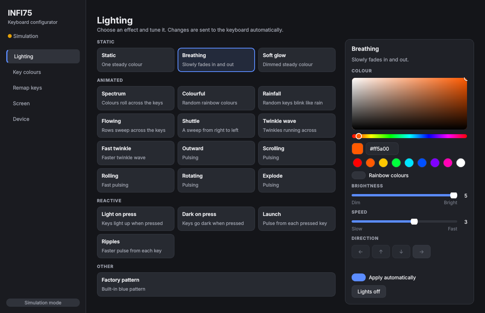
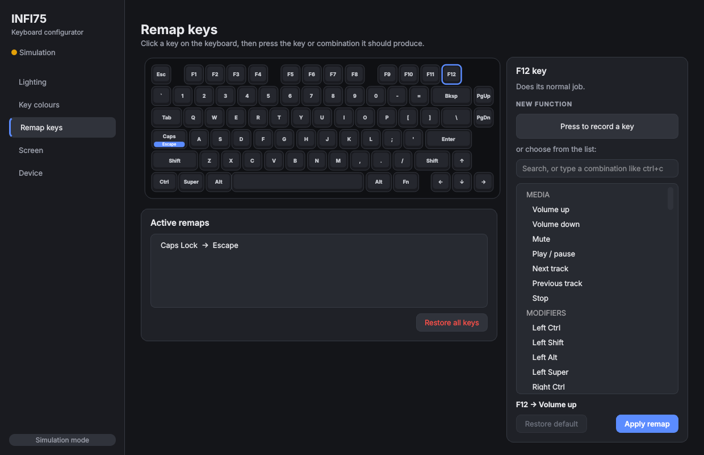
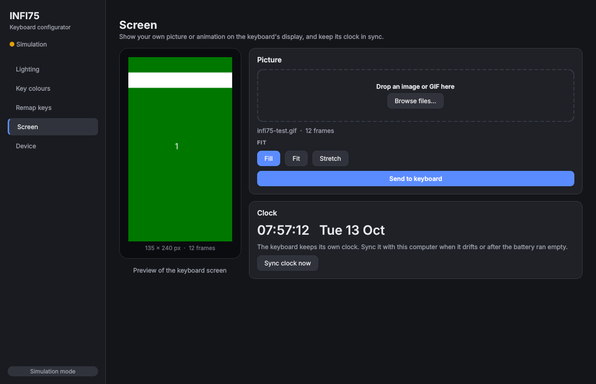
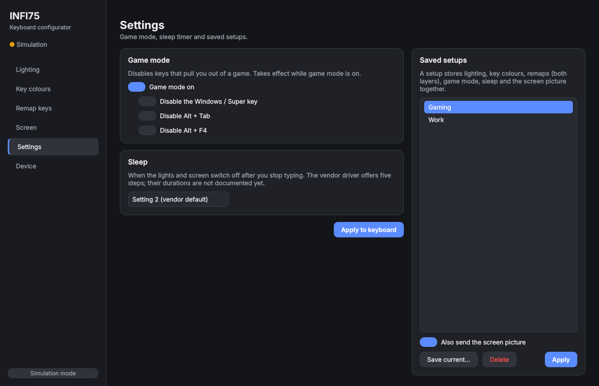

# infi75

Open-source configurator for the **Infiverse INFI75** keyboard: lighting,
per-key colours, key remapping and the built-in screen, from a GUI or the
command line. It works on keyboards that the official software cannot
connect to.


## Features

All confirmed on an INFI75-1.2 over USB on Linux:

| Area | What you can do |
|---|---|
| Lighting | 19 effects, colour or rainbow, brightness 0-5, speed 0-5, direction, lights off |
| Per-key colours | paint any keys, stored on the keyboard |
| Key remapping | any key to another key, a combination (`ctrl+c`) or a media key; restore and reset |
| Fn layer | what a key does while Fn is held (not yet confirmed on hardware) |
| Game mode, sleep | game mode with Win / Alt+Tab / Alt+F4 blocking; sleep timer (not yet confirmed on hardware) |
| Saved setups | store lighting, colours, remaps, game mode and screen under a name; switch with one click |
| Screen | still images and animated GIFs (135 x 240), with crop, stretch or letterbox fitting |
| Clock | set the screen clock to the computer's time, once or automatically (after login, periodically, on plug-in) |

Settings are stored on the keyboard and stay active over Bluetooth and
after unplugging.

## Requirements

- Linux (tested on CachyOS). Other systems are untested.
- Python 3.10 or newer and libusb 1.0:
  - Arch / CachyOS: `sudo pacman -S --needed python libusb`
  - Debian / Ubuntu: `sudo apt install python3-venv libusb-1.0-0`
- For the graphical app: Qt for Python (PySide6), installed by `pip install '.[gui]'` below.
- The keyboard connected **by USB cable, in wired mode**. Configuration does
  not work over Bluetooth (see below).

## Install

### Arch / CachyOS package (recommended)

```console
git clone https://github.com/GuyliandeJong/Infi75.git
cd Infi75/packaging/arch
makepkg -si
sudo pacman -S --needed pyside6                       # for the graphical app
systemctl --user enable --now infi75-clock.timer      # optional: automatic clock sync
```

The package installs the `infi75` command, the app-menu entry
"INFI75 Configurator", the permission rule (including the plug-in clock
sync) and the clock units. Replug the keyboard once afterwards. Update with
`git pull` and `makepkg -si` again.

### Python virtual environment (any distribution)

```console
git clone https://github.com/GuyliandeJong/Infi75.git
cd Infi75
python -m venv .venv
source .venv/bin/activate          # fish: source .venv/bin/activate.fish
pip install '.[gui]'               # or: pip install .   (command line only)
```

Give your user access to the keyboard (once), then unplug and replug it:

```console
infi75 udev | sudo tee /etc/udev/rules.d/70-infi75.rules
sudo udevadm control --reload && sudo udevadm trigger
```

Check that it is found:

```console
infi75 probe --usb 3
```

The output should list a collection with `usage_page=0xff13`.

Add the app to the application menu (optional):

```console
infi75 desktop install          # remove with: infi75 desktop uninstall
```

## Graphical configurator

```console
infi75 gui
```

The sidebar shows whether the keyboard is connected. If it is not reachable,
a banner explains what to do (connect the cable, switch to wired mode, or
install the permission rule).

| Page | What it does |
|---|---|
| **Lighting** | Effect tiles grouped as static, animated and reactive, each with a short description. Pick a colour on the colour wheel or a swatch, rainbow, brightness, speed and direction; controls an effect does not use are disabled. Changes are sent automatically after a short pause (sliders when released), so dragging does not cause dozens of writes. |
| **Key colours** | The keyboard drawn in its colours. Click a key, Shift-click to add, drag to select a group, or use the quick selections (letters, F-row, WASD, arrows). With keys selected, a colour click paints them. Presets: rainbow, gaming, rows, single colour, all off. Nothing is sent until **Apply to keyboard**; **Revert** undoes edits. |
| **Remap keys** | Click a key, then press **Press to record a key** and press the key or combination it should produce (for example Ctrl+C), or choose from the searchable list including media keys. **With Fn held** switches to the Fn layer; keys the keyboard reserves for its own Fn functions are grey. Remapped keys carry a badge; **Restore default** and **Restore all keys** undo. |
| **Screen** | Drop an image or GIF (or browse). The preview shows exactly what the screen will display, animated for GIFs, for each fit: fill, fit with black bars, or stretch. **Send to keyboard** shows progress. The clock card syncs the keyboard clock now, or turns on automatic sync. |
| **Settings** | Game mode (with Win, Alt+Tab and Alt+F4 blocking) and the sleep timer. **Saved setups**: save the current lighting, colours, remaps, game mode and screen picture under a name, and apply one with a click. |
| **Device** | Connection, firmware and a read-only check of both keyboard channels and the permission rule, the permission command with a copy button, simulation mode (shows the data, sends nothing) and the activity log. |

| Lighting | Remap keys |
|---|---|
|  |  |

| Screen | Settings |
|---|---|
|  |  |

## Command line

```console
infi75 rgb effects                                  # list effects with descriptions
infi75 rgb mode static --color "#ff8800" --brightness 5
infi75 rgb mode spectrum --rainbow --speed 4
infi75 rgb mode rolling --rainbow --direction left
infi75 rgb mode off

infi75 rgb all purple                               # every key one colour
infi75 rgb keys W=red A=red S=red D=red --default 0,0,40

infi75 keys                                         # key names
infi75 remap CAPS lctrl
infi75 remap F12 volup                              # volup voldown mute playpause next prev stop
infi75 remap RALT ctrl+c
infi75 remap CAPS default                           # restore one key
infi75 remap --fn F1 mute                           # Fn + F1 mutes
infi75 remap --list                                 # both layers
infi75 remap --reset                                # restore all keys (add --fn for the Fn layer)

infi75 system --game-mode on --block win,alttab     # --block none to allow everything
infi75 system --sleep 3                             # vendor steps 1-5
infi75 system                                       # show the last written values

infi75 setup save Gaming                            # store what is on the keyboard now
infi75 setup list
infi75 setup apply Work                             # --no-screen keeps the current picture
infi75 setup delete Gaming

infi75 screen image wallpaper.png                   # --fit crop (default) | stretch | pad
infi75 screen image animation.gif
infi75 clock sync                                   # set the keyboard clock now (same as: screen time)
infi75 clock install                                # sync after login, every 6 h and on plug-in
infi75 clock install --every 1h                     # other interval (minimum 5min)
infi75 clock status
infi75 clock uninstall

infi75 --dry-run rgb all red                        # print packets, send nothing
infi75 --trace remap A d                            # send, and print every packet and reply
```

Colours can be names (`red`, `orange`, `purple`, `off`, ...), `#rrggbb`
or `r,g,b`.

The keyboard replaces its whole remap table on every write, so the tool
keeps your remaps in `~/.config/infi75/keymap.json` and sends all of them
each time (`keymap-fn.json` for the Fn layer). The app also remembers the
last applied lighting (`lighting.json`), key colours (`colors.json`), game
mode and sleep (`system.json`) and screen picture (`screen.json`) in the
same folder, so it opens showing what is on the keyboard. Saved setups are
snapshots of these files in `setups/`.

## Automatic clock sync

The keyboard clock drifts and cannot fetch the time itself. `infi75 clock
install` (or the switch on the Screen page) writes two systemd user units to
`~/.config/systemd/user/`:

| Unit | Does |
|---|---|
| `infi75-clock.service` | runs `infi75 clock sync --if-present` once; exits quietly when the keyboard is not on USB |
| `infi75-clock.timer` | starts the service 30 s after login and then every 6 hours |

The udev rule from `infi75 udev` also starts the service whenever the
keyboard is plugged in or switched to wired mode
(`ENV{SYSTEMD_USER_WANTS}`). Reinstall the rule after updating:

```console
infi75 udev | sudo tee /etc/udev/rules.d/70-infi75.rules
sudo udevadm control --reload
```

Logs: `journalctl --user -u infi75-clock`. Every sync ends with the
keyboard's SAVE command, which writes its settings memory, so the interval
has a 5-minute minimum.

## Why the official software does not work

The INFI75-1.2 firmware describes its configuration interface (USB
interface 3) without the input endpoint every HID driver requires, so the
operating system ignores the interface and the official INFI75 driver and
the Epomaker web hub never find it. Its configuration messages travel over
the USB control channel, which this tool uses directly through libusb.
Screen images go through interface 2, which works normally.

Over Bluetooth the keyboard offers no configuration channel at all; the
Bluetooth module rejects the commands. Configure it over the cable, then
switch back to Bluetooth.

The full protocol is documented in [docs/PROTOCOL.md](docs/PROTOCOL.md).

## Troubleshooting

| Symptom | Fix |
|---|---|
| `Keyboard not found` / `not found` errors | Cable connected? Keyboard switched to wired mode? Run `lsusb` and look for `05ac:024f`. |
| `Access denied`, `open failed`, `cannot claim interface` | Install the udev rule (see Install) and replug the keyboard. |
| GUI says "Bluetooth only" | Connect the cable and switch the keyboard to wired mode. |
| `the GUI needs PySide6` | `pip install '.[gui]'` in the project folder, or `sudo pacman -S pyside6`. |
| `warning: no confirmation for 04 02` | The keyboard was still saving; the setting is normally applied anyway. |
| Per-key colours flash and then revert | Update to the current version; old versions used the preview command. |

## Development

```console
pip install -e ".[dev]"
pytest
```

| Module | Role |
|---|---|
| `hfd.py` | INFI75 packet builders and session (acknowledgement handling) |
| `board.py` | INFI75 operations shared by the CLI and the GUI |
| `usbctl.py` | libusb control transfers for the unbound configuration interface |
| `ui/` | graphical app (PySide6): `app.py` window and background work, `pages.py`, `widgets.py` (colour picker, keyboard view, key capture), `theme.py` |
| `cli.py`, `gui.py` | command line; GUI entry point |
| `screen.py` | image and GIF conversion to RGB565 |
| `probe.py` | read-only interface and descriptor probing |
| `capture.py` | pcap/pcapng (USBPcap, usbmon) parsing, diff and replay for protocol work |
| `profile.py`, `profiles/infi75.json` | key layout, slots and USB identity |
| `protocol.py`, `transport.py`, `device.py` | Royuan protocol for older Epomaker boards (VID `0x3151`, e.g. RT100), selected by a profile with `"protocol": "royuan"` |

## Safety

The tool writes settings the same way the official driver does and never
writes firmware. Do not run the firmware updaters shipped with the official
driver package on an INFI75-1.2: they were built for a different firmware
revision (see [docs/PROTOCOL.md](docs/PROTOCOL.md#10-firmware-updaters-warning)).

## Credits and license

MIT license. Protocol knowledge builds on
[gohv/EPOMAKER-Ajazz-AK820-Pro](https://github.com/gohv/EPOMAKER-Ajazz-AK820-Pro),
[OpenRGB](https://gitlab.com/CalcProgrammer1/OpenRGB) and
[epomaker-controller](https://github.com/strodgers/epomaker-controller).
