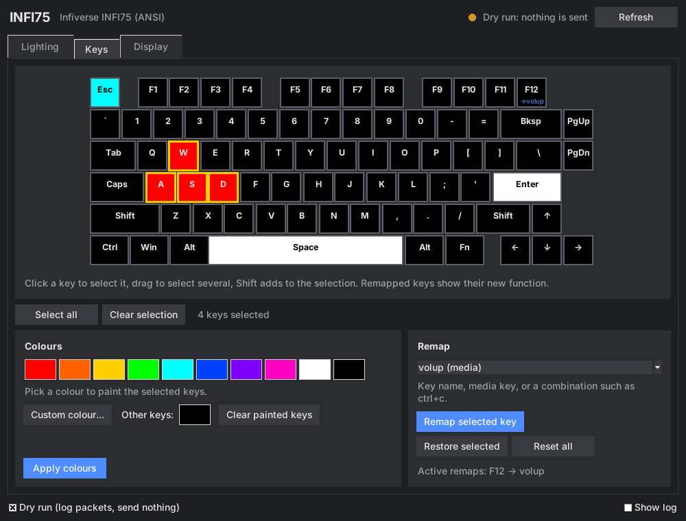
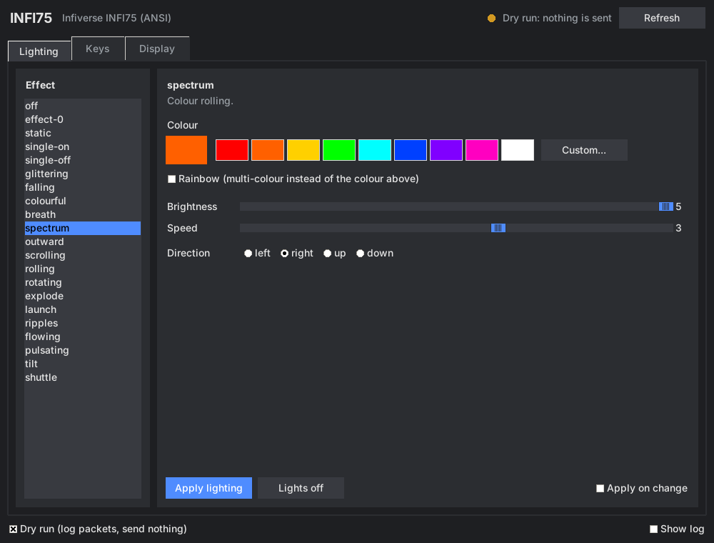
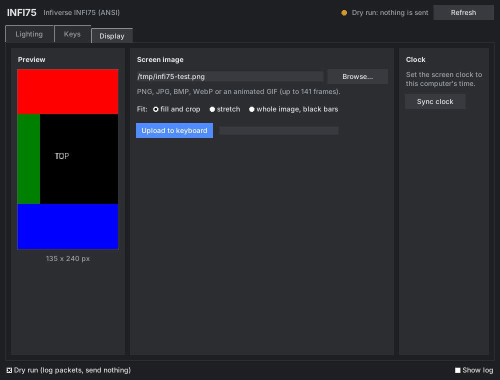

# infi75

Open-source configurator for the **Infiverse INFI75** keyboard: lighting,
per-key colours, key remapping and the built-in screen, from a GUI or the
command line. It works on keyboards that the official software cannot
connect to.



## Features

All confirmed on an INFI75-1.2 over USB on Linux:

| Area | What you can do |
|---|---|
| Lighting | 19 effects, colour or rainbow, brightness 0-5, speed 0-5, direction, lights off |
| Per-key colours | paint any keys, stored on the keyboard |
| Key remapping | any key to another key, a combination (`ctrl+c`) or a media key; restore and reset |
| Screen | still images and animated GIFs (135 x 240), with crop, stretch or letterbox fitting |
| Clock | set the screen clock to the computer's time |

Settings are stored on the keyboard and stay active over Bluetooth and
after unplugging.

## Requirements

- Linux (tested on CachyOS). Other systems are untested.
- Python 3.10 or newer, libusb 1.0 and Tk:
  - Arch / CachyOS: `sudo pacman -S --needed python libusb tk`
  - Debian / Ubuntu: `sudo apt install python3-venv libusb-1.0-0 python3-tk`
- The keyboard connected **by USB cable, in wired mode**. Configuration does
  not work over Bluetooth (see below).

## Install

```console
git clone https://github.com/GuyliandeJong/Infi75.git
cd Infi75
python -m venv .venv
source .venv/bin/activate          # fish: source .venv/bin/activate.fish
pip install .
```

Give your user access to the keyboard (once), then unplug and replug it:

```console
infi75 udev | sudo tee /etc/udev/rules.d/70-infi75.rules
sudo udevadm control --reload && sudo udevadm trigger
```

Check that it is found:

```console
infi75 probe --usb 3
```

The output should list a collection with `usage_page=0xff13`.

## Graphical configurator

```console
infi75 gui
```

The header shows whether the keyboard is reachable: connected by USB,
connected by Bluetooth only (cannot be configured), or not found.

| Tab | Use |
|---|---|
| **Lighting** | Pick an effect from the list (each has a short description), a colour or rainbow, brightness, speed and direction, then **Apply lighting**. With **Apply on change** every adjustment is sent immediately. |
| **Keys** | The keyboard is drawn in its current colours. Click a key, Shift-click to add keys, or drag to select a group. Click a palette colour to paint the selection, choose a colour for all other keys, then **Apply colours**. To remap, select one key, choose a target and press **Remap selected key**; remapped keys show their new function on the drawing. |
| **Display** | Choose an image or GIF; the preview shows exactly what the screen will display for the chosen fit. **Upload to keyboard** shows progress. **Sync clock** sets the screen clock. |

Tick **Dry run** to see the packets in the log without sending anything.

| Lighting | Display |
|---|---|
|  |  |

## Command line

```console
infi75 rgb effects                                  # list effects with descriptions
infi75 rgb mode static --color "#ff8800" --brightness 5
infi75 rgb mode spectrum --rainbow --speed 4
infi75 rgb mode rolling --rainbow --direction left
infi75 rgb mode off

infi75 rgb all purple                               # every key one colour
infi75 rgb keys W=red A=red S=red D=red --default 0,0,40

infi75 keys                                         # key names
infi75 remap CAPS lctrl
infi75 remap F12 volup                              # volup voldown mute playpause next prev stop
infi75 remap RALT ctrl+c
infi75 remap CAPS default                           # restore one key
infi75 remap --list
infi75 remap --reset                                # restore all keys

infi75 screen image wallpaper.png                   # --fit crop (default) | stretch | pad
infi75 screen image animation.gif
infi75 screen time

infi75 --dry-run rgb all red                        # print packets, send nothing
```

Colours can be names (`red`, `orange`, `purple`, `off`, ...), `#rrggbb`
or `r,g,b`.

The keyboard replaces its whole remap table on every write, so the tool
keeps your remaps in `~/.config/infi75/keymap.json` and sends all of them
each time. The GUI also remembers the last applied key colours in
`~/.config/infi75/colors.json`.

## Why the official software does not work

The INFI75-1.2 firmware describes its configuration interface (USB
interface 3) without the input endpoint every HID driver requires, so the
operating system ignores the interface and the official INFI75 driver and
the Epomaker web hub never find it. Its configuration messages travel over
the USB control channel, which this tool uses directly through libusb.
Screen images go through interface 2, which works normally.

Over Bluetooth the keyboard offers no configuration channel at all; the
Bluetooth module rejects the commands. Configure it over the cable, then
switch back to Bluetooth.

The full protocol is documented in [docs/PROTOCOL.md](docs/PROTOCOL.md).

## Troubleshooting

| Symptom | Fix |
|---|---|
| `Keyboard not found` / `not found` errors | Cable connected? Keyboard switched to wired mode? Run `lsusb` and look for `05ac:024f`. |
| `Access denied`, `open failed`, `cannot claim interface` | Install the udev rule (see Install) and replug the keyboard. |
| GUI says "Bluetooth only" | Connect the cable and switch the keyboard to wired mode. |
| `warning: no confirmation for 04 02` | The keyboard was still saving; the setting is normally applied anyway. |
| Per-key colours flash and then revert | Update to the current version; old versions used the preview command. |

## Development

```console
pip install -e ".[dev]"
pytest
```

| Module | Role |
|---|---|
| `hfd.py` | INFI75 packet builders and session (acknowledgement handling) |
| `board.py` | INFI75 operations shared by the CLI and the GUI |
| `usbctl.py` | libusb control transfers for the unbound configuration interface |
| `gui.py`, `cli.py` | user interfaces |
| `screen.py` | image and GIF conversion to RGB565 |
| `probe.py` | read-only interface and descriptor probing |
| `capture.py` | pcap/pcapng (USBPcap, usbmon) parsing, diff and replay for protocol work |
| `profile.py`, `profiles/infi75.json` | key layout, slots and USB identity |
| `protocol.py`, `transport.py`, `device.py` | Royuan protocol for older Epomaker boards (VID `0x3151`, e.g. RT100), selected by a profile with `"protocol": "royuan"` |

## Safety

The tool writes settings the same way the official driver does and never
writes firmware. Do not run the firmware updaters shipped with the official
driver package on an INFI75-1.2: they were built for a different firmware
revision (see [docs/PROTOCOL.md](docs/PROTOCOL.md#9-firmware-updaters-warning)).

## Credits and license

MIT license. Protocol knowledge builds on
[gohv/EPOMAKER-Ajazz-AK820-Pro](https://github.com/gohv/EPOMAKER-Ajazz-AK820-Pro),
[OpenRGB](https://gitlab.com/CalcProgrammer1/OpenRGB) and
[epomaker-controller](https://github.com/strodgers/epomaker-controller).
