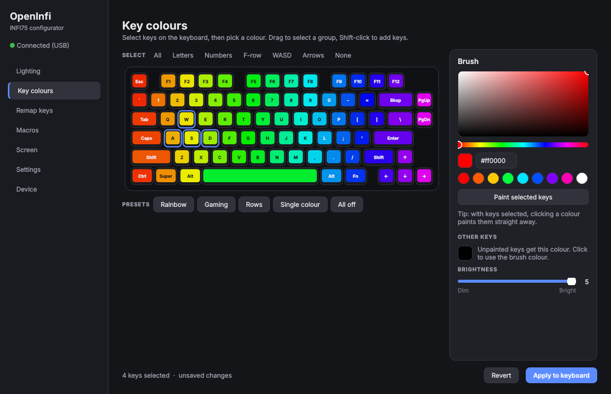
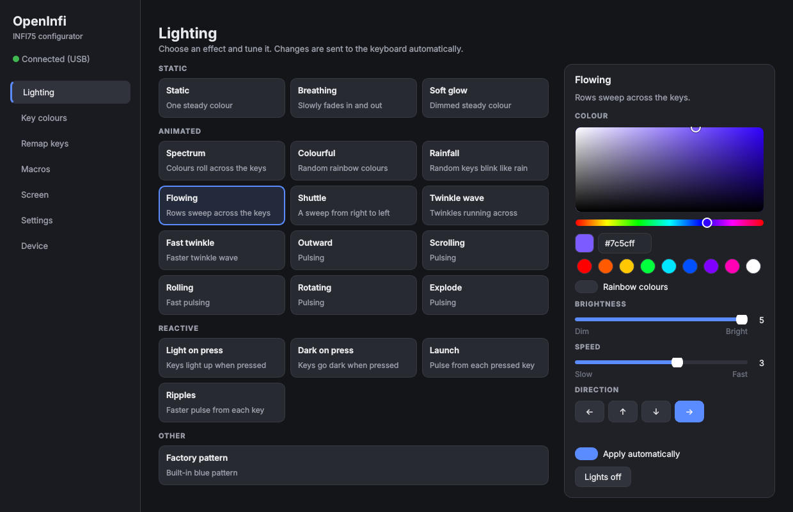
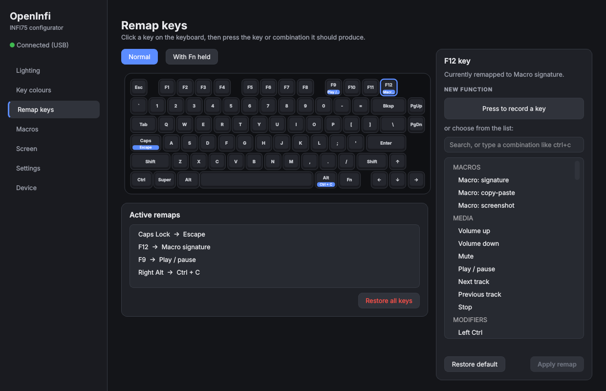
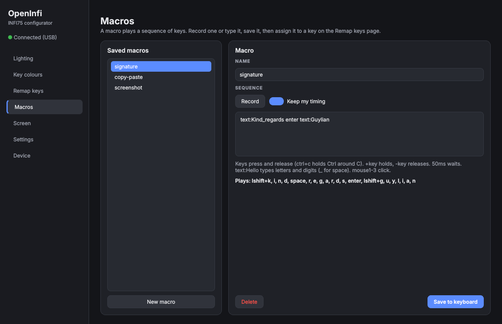
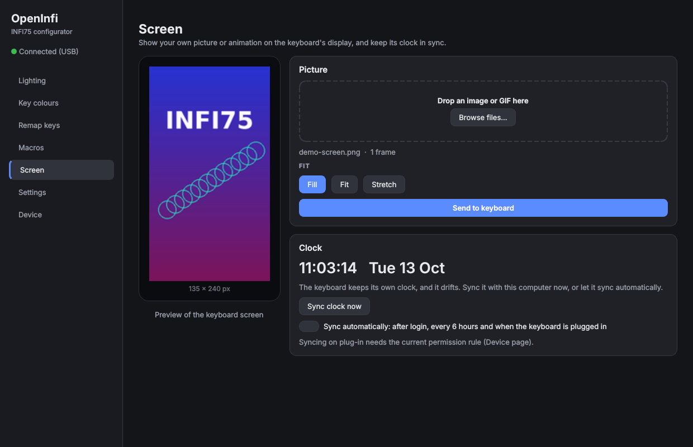
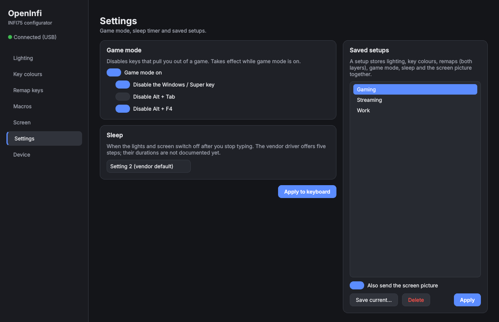
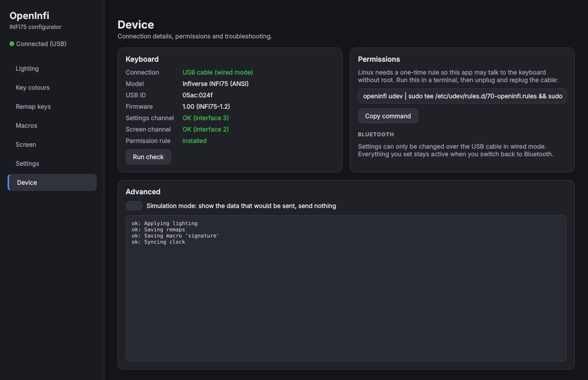

# OpenInfi

**OpenInfi** is an open-source configurator for the **Infiverse INFI75** keyboard on Linux.

Change the lighting, paint every key, remap keys and the Fn layer, record macros, put your own picture or GIF on the built-in screen and keep its clock right, all without the Windows-only vendor software. It also works on INFI75 keyboards that the official driver and the Epomaker web hub cannot connect to.

## Preview



## Features

Everything you set is stored on the keyboard itself, so it keeps working after unplugging, on other computers and over Bluetooth.

### Lighting

All 20 built-in effects, grouped as static, animated and reactive, each with a short description.

- Colour wheel, swatches or rainbow colours
- Brightness and speed (0-5), and direction for the effects that move
- Controls an effect does not use are greyed out
- Changes are sent automatically after a short pause, so dragging a slider does not cause dozens of writes
- Lights off with one click



### Key Colours

Paint every key its own colour on a picture of your keyboard.

- Click a key, Shift-click to add more, or drag to select a group
- Quick selections: letters, numbers, F-row, WASD, arrows
- Presets: rainbow, gaming, rows, single colour, all off
- A colour for all unpainted keys, and the brightness
- Nothing is sent until **Apply to keyboard**; **Revert** undoes your edits

### Key Remapping

Make any key do something else: another key, a combination such as Ctrl+C, a media key or a macro.

- Click a key, press **Press to record a key** and press what it should produce, or search the list
- **With Fn held** remaps the Fn layer: what a key does while Fn is pressed. Keys the keyboard reserves for its own Fn functions are greyed out
- Remapped keys carry a badge; restore one key or all keys at once



### Macros

A macro plays a sequence of keys from a single key press.

- **Record** a sequence, optionally keeping your own timing, or type it as text: `ctrl+c 50ms ctrl+v`, `text:Hello`, `+shift a -shift`, `mouse1`
- A live preview shows what the macro will play
- Assign it to any key on the Remap page, optionally repeated several times



### Screen

Put your own picture or animated GIF on the 135×240 display.

- Drag and drop, or browse
- The preview shows exactly what the screen will show, animated for GIFs
- Fill (crop), fit (black bars) or stretch
- Progress while the picture is sent



### Clock Sync

The keyboard clock drifts and cannot fetch the time itself. Sync it with one click, or let it sync automatically after login, every 6 hours and whenever the keyboard is plugged in.

### Game Mode, Sleep and Saved Setups

- **Game mode** disables the Windows key, Alt+Tab and Alt+F4 while you play
- **Sleep timer** for the lights and screen
- **Saved setups**: store lighting, key colours, remaps, macros, game mode and the screen picture under a name, and switch with one click



### Device Check

The Device page shows the connection, firmware and whether both keyboard channels and the permission rule work, with the one command needed to fix permissions. **Simulation mode** shows the data that would be sent without touching the keyboard.



### Command Line

Everything in the app is also available as `openinfi` commands, for scripts and key bindings. See [Command Line](#command-line-1) below.

## Status

| Feature | Status |
| --- | --- |
| Lighting, key colours, key remapping, screen pictures and GIFs, clock | Working, tested on an INFI75-1.2 |
| Fn layer, macros, game mode, sleep timer | Built from the official driver's protocol; not yet tested on the keyboard |
| Reading the current colours back from the keyboard (`openinfi rgb read`) | Experimental |

Reports from other INFI75 owners are welcome: open an issue with the output of `openinfi probe --usb 3`.

## Requirements

- Linux (developed on CachyOS). Windows and macOS are not supported.
- Python 3.10 or newer and libusb 1.0
- PySide6 (Qt for Python) for the graphical app
- The keyboard connected **by USB cable, in wired mode**. Settings cannot be changed over Bluetooth; see [Why the official software does not work](#why-the-official-software-does-not-work).

## Installation

### Arch Linux / CachyOS (recommended)

```bash
git clone https://github.com/GuyliandeJong/OpenInfi.git
cd OpenInfi/packaging/arch
makepkg -si
sudo pacman -S --needed pyside6
```

This installs the `openinfi` command, **OpenInfi** in the application menu, the permission rule and the clock sync. Unplug and replug the keyboard once afterwards.

Update later with `git pull` and `makepkg -si` in the same folder.

### Any Distribution (virtual environment)

Install Python and libusb first:

```bash
sudo pacman -S --needed python libusb          # Arch / CachyOS
sudo apt install python3-venv libusb-1.0-0     # Debian / Ubuntu
```

Clone the repository and install:

```bash
git clone https://github.com/GuyliandeJong/OpenInfi.git
cd OpenInfi
python -m venv .venv
source .venv/bin/activate          # fish: source .venv/bin/activate.fish
pip install '.[gui]'
```

Give your user access to the keyboard (once), then unplug and replug it:

```bash
openinfi udev | sudo tee /etc/udev/rules.d/70-openinfi.rules
sudo udevadm control --reload && sudo udevadm trigger
```

Optionally add the app to the application menu and turn on automatic clock sync:

```bash
openinfi desktop install
openinfi clock install
```

### Start

```bash
openinfi gui
```

## Upgrading from infi75

OpenInfi was called `infi75` before. After updating, your saved settings move from `~/.config/infi75` to `~/.config/openinfi` by themselves. Replace the old permission rule, clock sync and menu entry once:

```bash
sudo rm -f /etc/udev/rules.d/70-infi75.rules
openinfi udev | sudo tee /etc/udev/rules.d/70-openinfi.rules
sudo udevadm control --reload && sudo udevadm trigger
openinfi clock install        # also removes the old infi75 clock units
openinfi desktop install      # also removes the old menu entry
```

With the Arch package, `makepkg -si` replaces the old `infi75` package; only remove the hand-installed rule in `/etc/udev/rules.d/`.

## Command Line

```bash
openinfi rgb effects                                  # list effects
openinfi rgb mode static --color "#ff8800" --brightness 5
openinfi rgb mode spectrum --rainbow --speed 4
openinfi rgb mode off
openinfi rgb all purple                               # every key one colour
openinfi rgb keys W=red A=red S=red D=red --default 0,0,40

openinfi keys                                         # key names
openinfi remap CAPS esc
openinfi remap RALT ctrl+c
openinfi remap F12 volup                              # volup voldown mute playpause next prev stop
openinfi remap --fn F1 mute                           # Fn + F1
openinfi remap CAPS default                           # restore one key
openinfi remap --list
openinfi remap --reset                                # restore all keys (--fn for the Fn layer)

openinfi macro save sig "text:Kind_regards enter"     # _ types a space
openinfi remap F9 macro:sig                           # macro:sigx3 plays it 3 times

openinfi screen image wallpaper.png                   # --fit crop (default) | pad | stretch
openinfi screen image animation.gif
openinfi clock sync
openinfi clock install --every 1h                     # automatic sync; 'clock status', 'clock uninstall'

openinfi system --game-mode on --block win,altf4
openinfi system --sleep 3
openinfi setup save Gaming
openinfi setup apply Work

openinfi --dry-run rgb all red                        # print the data, send nothing
openinfi --trace remap A d                            # send, and print every packet and reply
```

Colours can be names (`red`, `orange`, `purple`, `off`, ...), `#rrggbb` or `r,g,b`.

## Why the official software does not work

The INFI75-1.2 firmware describes its settings interface (USB interface 3) without the input endpoint that every operating system's HID driver requires. Linux and Windows therefore ignore the interface, and the official driver and the Epomaker web hub never find the keyboard. This tool sends the settings over the USB control channel through libusb instead, which does not need that endpoint. Screen pictures go through interface 2, which works normally.

Over Bluetooth the keyboard offers no settings channel at all. Change the settings over the cable, then switch back to Bluetooth; they stay active.

The full protocol is documented in [docs/PROTOCOL.md](docs/PROTOCOL.md).

## Troubleshooting

| Problem | Fix |
| --- | --- |
| Keyboard not found | Is the cable connected and the keyboard in wired mode? `lsusb` should list `05ac:024f`. |
| `Access denied`, `open failed`, `cannot claim interface` | Install the permission rule (see Installation) and replug the keyboard. |
| The app says "Bluetooth only" | Connect the cable and switch the keyboard to wired mode. |
| `the GUI needs PySide6` | `pip install '.[gui]'` in the project folder, or `sudo pacman -S pyside6`. |
| `warning: no confirmation for 04 02` | The keyboard was still saving; the setting is normally applied anyway. |
| Automatic clock sync does nothing | `journalctl --user -u openinfi-clock`; reinstall the permission rule after updating. |

Settings this tool has written are remembered in `~/.config/openinfi/`.

## Safety

The tool writes settings the same way the official driver does and never writes firmware. Do **not** run the firmware updaters that come with the official driver package on an INFI75-1.2: they were built for a different revision (see [docs/PROTOCOL.md](docs/PROTOCOL.md#10-firmware-updaters-warning)).

## Running the Tests

```bash
pip install -e '.[gui,dev]'
QT_QPA_PLATFORM=offscreen pytest
```

The tests need no keyboard. GitHub Actions runs them, plus `pyflakes`, on Python 3.10, 3.12 and 3.13 for every push.

## Project Structure

```text
OpenInfi/
├── src/openinfi/
│   ├── hfd.py              INFI75 protocol: packet builders and the session
│   ├── board.py            keyboard operations shared by the app and the command line
│   ├── usbctl.py           libusb access to the settings interface
│   ├── macro.py            macro text form
│   ├── screen.py           picture and GIF conversion
│   ├── clock.py            automatic clock sync (systemd user units)
│   ├── desktop.py          application-menu entry
│   ├── cli.py              command line
│   ├── ui/                 graphical app (PySide6)
│   ├── probe.py, capture.py  tools for protocol research
│   └── profiles/infi75.json  key layout and USB identity
├── tests/                  unit tests (no keyboard needed)
├── packaging/arch/         PKGBUILD for Arch Linux / CachyOS
├── docs/PROTOCOL.md        the INFI75 USB protocol
├── screenshots/            pictures used in this README
└── README.md
```

## Roadmap

Done so far: lighting, key colours, remapping, Fn layer, macros, screen pictures and GIFs, automatic clock sync, game mode and sleep timer, saved setups, Arch package.

Next, roughly in this order:

1. Confirm the Fn layer, macros, game mode and sleep timer on the keyboard
2. Show the keyboard's current colours in the app (`openinfi rgb read`)
3. An AUR package
4. More INFI75 layouts (ISO) and revisions

## Support

If you find OpenInfi useful and would like to support its development:

[](https://ko-fi.com/guyliandejong)

## Credits

Protocol knowledge builds on [gohv/EPOMAKER-Ajazz-AK820-Pro](https://github.com/gohv/EPOMAKER-Ajazz-AK820-Pro), [OpenRGB](https://gitlab.com/CalcProgrammer1/OpenRGB) and [epomaker-controller](https://github.com/strodgers/epomaker-controller).

## License

MIT License, see [LICENSE](LICENSE).

OpenInfi is an independent project and is not affiliated with or endorsed by Infiverse or Epomaker. No vendor software or firmware is included.
